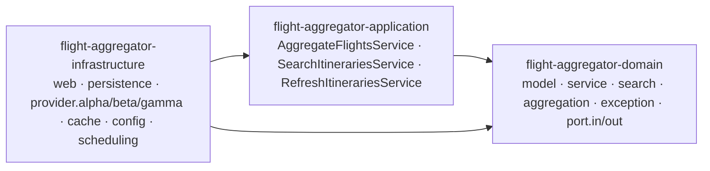
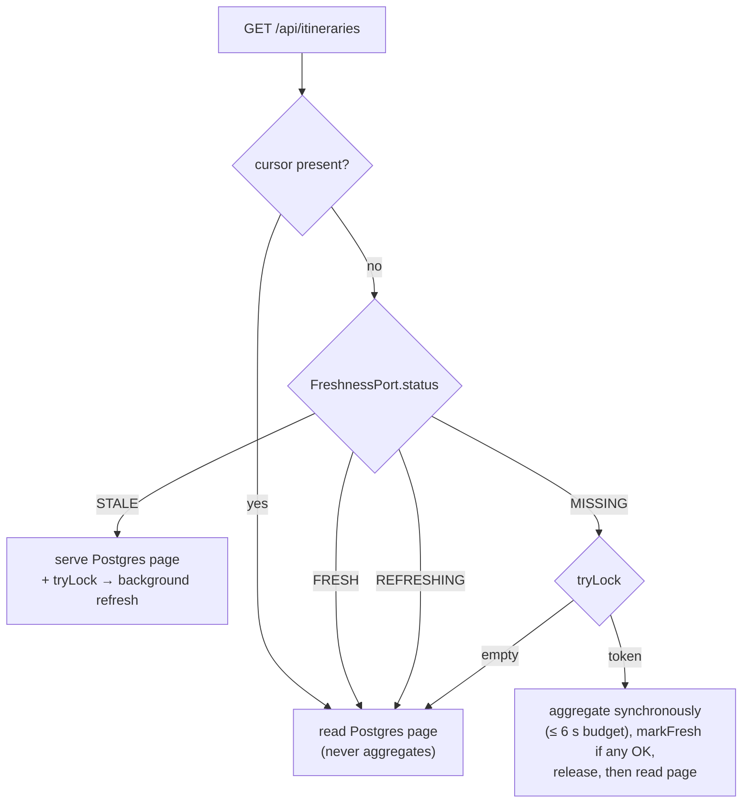

# SOLUTION.md

## 1. Overview

The system aggregates flight itineraries from three simulated GDS providers. It validates them, deduplicates identical products and keeps the cheapest, applies a 5% markup, stores the result in PostgreSQL, and serves it through a search API with keyset pagination and a React dashboard. There are three projects: `flight-aggregator` (Java 21, Spring Boot 4.1.2, hexagonal), `mock-providers` (Alpha JSON, Beta XML, Gamma streamed CSV, with artificial latency and errors) and `frontend` (React + Vite behind nginx). `docker compose up --build` starts all five services (`postgres`, `redis`, `mock-providers`, `flight-aggregator`, `frontend`), and `scripts/smoke.sh` checks the running stack.

The record of how it was built is in [`docs/ai-log.md`](docs/ai-log.md). The prompts are kept in the repository (§3).

Where to find what the brief asks for:

| The brief asks for | Section |
|---|---|
| Architectural decisions | §2 |
| AI tools, prompts and agent systems | §3 |
| Data model and pagination up to 1,000,000 rows | §4 |
| Tests | §5 |
| Limitations and trade-offs | §6, with next steps in §7 |

## 2. Architectural decisions

### 2.1 Modules and dependency rules



There are three Maven modules. `domain` has no compile dependency: only JUnit and AssertJ, in test scope. `application` depends on `domain` alone. `infrastructure` is the only Spring Boot module.

The poms enforce the direction. `ArchitectureTest` enforces what the poms cannot. It has **12** `@ArchTest` rules:

- `domain_depends_only_on_jdk_and_itself`, `application_depends_only_on_jdk_and_domain` and `domain_has_no_framework_annotations` keep the inner modules framework-free.
- `model_does_not_depend_on_service_search_or_aggregation` and `aggregation_does_not_depend_on_search_or_service` enforce the package direction inside the domain.
- `web_does_not_touch_outbound_adapters` and `controllers_depend_only_on_inbound_ports_and_web` isolate the web adapter.
- `jpa_entities_stay_in_persistence` and `provider_dtos_stay_in_their_adapter` keep JPA entities and provider DTOs in their own packages.
- `ports_are_interfaces`, `no_field_injection` and `layers_point_inwards` cover the rest.

**One `infrastructure` module, not one module per adapter.** Each adapter is a package (`web`, `persistence`, `provider.alpha|beta|gamma`, `cache`), and ArchUnit keeps them apart. This means one Spring Boot application, one test classpath and one Dockerfile. *Cost:* the boundaries hold only while `ArchitectureTest` runs. The compiler alone would let `web` import a JPA entity.

**Inside the domain:**

| Package | Holds |
|---|---|
| `model` | `Itinerary`, `Segment`, `Offer`, `ItineraryKey`, `Price`, `Airport`, `Carrier`, `FlightNumber`, `Provider`, `RejectionReason`, `MarkupPolicy`, `PercentageMarkupPolicy` |
| `service` | `OfferValidator`, `OfferValidation`, `ValidationSummary`, `ItineraryDeduplicator`, `ItineraryFactory` |
| `search` | `SearchCriteria`, `ItineraryFilter`, `PageCursor`, `ItineraryPage`, `SearchResult`, `Freshness`, `LockToken` |
| `aggregation` | `AggregationResult`, `ProviderOutcome`, `ProviderResponse`, `ProviderStatus` |
| `exception` | `DomainException` and its 11 subclasses |
| `port.in` / `port.out` | Use cases; `FlightProviderPort`, `ItineraryRepositoryPort`, `FreshnessPort` |

`service` knows `model`; `model` never knows `service`, `search` or `aggregation`. The two package rules above enforce this. `MarkupPolicy` lives in `model` because `Itinerary` needs it to derive its final price. `Itinerary.findViolation` is public: it is the single implementation of invariants I1–I9, used by the aggregate's own factories and by `OfferValidator`, which needs a result instead of an exception. *Accepted cost:* `exception` and `model` depend on each other, because exceptions carry the types they report. The grouping was chosen for readability, not to make the packages acyclic.

### 2.2 Read path and write path

Searches read Postgres and never call providers directly. The aggregation is the only writer. Redis decides which path a search takes.



| State | Meaning (Redis) | Behaviour |
|---|---|---|
| FRESH | `fresh:` key present | Serve from Postgres |
| STALE | only `seen:` present, or Redis unreachable | Serve from Postgres; refresh on `refreshExecutor` if the lock is free |
| REFRESHING | `lock:` present | Serve from Postgres; start nothing |
| MISSING | nothing | Aggregate under the lock, then serve |

Pages after the first never trigger an aggregation (`SearchItinerariesService`: "A cursor request never aggregates").

#### Where the cache is, and why

The cache protects the providers, not the database. The expensive resource is a provider call (up to 5 s, 10% failures); a page read from Postgres is not. So Redis records *whether a route needs aggregating*, and Postgres is the stored result.

**Redis holds** three keys per route and date (`FreshnessKeys`): `fresh:` (marker, TTL `FRESHNESS_TTL` 10 min), `seen:` (the last `AggregationResult` as JSON, TTL `max(7 days, 2 × freshness TTL)`), and `lock:` (owner token, TTL `LOCK_TTL` 30 s). **Redis does not hold** itineraries or result pages. Caching pages was rejected for three reasons: a keyset page from Postgres costs under 1 ms (§4.3), a cached page goes stale after every upsert, and each filter and cursor combination would need its own key. *Cost:* every search hits Postgres.

**Lock.** `tryLock` uses `SET NX` with a UUID `LockToken`. `release` is a Lua compare-and-delete, so a holder whose lock has expired cannot delete a newer holder's lock (`RedisFreshnessAdapterIT`). **Fail closed:** if Redis is unreachable, `status` returns STALE and `tryLock` returns empty, so nothing aggregates (§6). The container healthcheck is `/actuator/health/liveness` (Dockerfile and `docker-compose.yml`), so a Redis outage does not restart the service.

### 2.3 Resilience

**Fan-out.** `AggregateFlightsService` starts one `CompletableFuture` per provider and waits up to `PROVIDER_BUDGET` (6 s). A provider still running then is reported as TIMEOUT and its call is abandoned. Each task catches `Exception`. An `Error` (OOM, StackOverflow) is unwrapped from the `CompletionException` and rethrown, because a JVM failure must not be reported as a provider outcome.

**Per provider:** `ProviderResilience` wraps each call as Retry(CircuitBreaker(TimeLimiter)). The settings are 2 attempts, and a breaker window of 10 calls that opens at 50% failures and stays open 30 s. Calls run on a virtual-thread executor (`ProviderConfiguration`). A provider call can fail in four ways:

| Kind | Example | Result | Retried | Counts for breaker |
|---|---|---|---|---|
| One itinerary unmappable | dead leg, null entry, `"price":"abc"` | Skipped, counted in `ProviderResponse.unmappable`; response OK | — | — |
| Contract violation (`ProviderContractViolation`) | unreadable JSON/XML, Beta without `Itineraries`, wrong Gamma header | ERROR | No | Yes |
| Request rejected (`ProviderRequestRejected`) | 4xx except 408/429 | ERROR | No | No (ignored) |
| Transport failure | 5xx, 408, 429, reset, Gamma stream without `#END` | ERROR | Yes | Yes |

`BetaProviderAdapterIT.should_report_error_after_exactly_one_request_when_body_is_not_readable_xml` shows that a 200 with an unreadable body is not retried. The `..._when_beta_answers_400` test shows that a 400 leaves the breaker's failure count unchanged.

**Timeout 5.5 s, budget 6 s.** The first defaults were 3 s and 3.5 s. The brief's provider latency is 100 ms – 5 s, uniform in the mock, so a 3 s timeout cut off about 40% of calls that would have succeeded. Together with the 10% error rate, the breakers opened within minutes on the default stack, and a new route returned zero items with every provider CIRCUIT_OPEN. The WireMock tests did not show this, because they use fixed delays. Running the full stack did. *Cost:* the first search of a new route can take up to 6 s.

### 2.4 Anti-corruption layers

Each provider package has its own DTOs (raw strings), parser, mapper and client. Only a domain `ProviderResponse` leaves the package.

| | Alpha (JSON) | Beta (XML) | Gamma (CSV stream) |
|---|---|---|---|
| Time | ISO UTC | local time + IANA zone → `ZonedDateTime…withEarlierOffsetAtOverlap()`; a time in the spring gap is unmappable | `yyyyMMddHHmm` UTC |
| Price | decimal, parsed in `AlphaOfferMapper` | string `amount` attribute | `price_cents` ÷ 10^`getDefaultFractionDigits()` |
| Flight number | `"0117"` and `"117"` are both accepted | airline code + unpadded `Number` | `BA;0117` packed in a field |
| Ordering | in order | legs out of order; sorted by `sequence`, which must read 1..n | in order; stream must end with `#END` |

`FlightNumber` normalises leading zeros, so `IB0117` equals `IB117` and the Itinerary Key matches across providers.

### 2.5 Technology choices

- **Spring Boot 4.1.2 / Java 21:** the only line with OSS support covering the delivery (ai-log, 2026-11-13). *Cost:* Jackson 3 and the modular starters are recent, with fewer examples to copy.
- **Flyway + `ddl-auto=validate`:** the schema and indexes are a reviewed file (`V1__create_itineraries.sql`), and a column mismatch fails boot. *Cost:* each schema change needs a migration.
- **`RestClient`:** a synchronous client, because the service is not reactive.
- **Virtual threads:** blocking fan-out and Gamma streaming without sizing a thread pool. *Cost:* an abandoned Gamma read runs until its read timeout (§6).
- **Resilience4j, programmatic:** one `ProviderResilience` shared by the three adapters, with retry and ignore predicates that are unit-testable. *Cost:* no annotation-driven configuration and no automatic metrics.

## 3. AI tools utilised

### 3.1 The system

- **Standing rules:** one `AGENTS.md` per scope (root, `flight-aggregator`, `mock-providers`, `frontend`) with the stack, the forbidden imports, the Ubiquitous Language and the commands.
- **Sources of truth, written before the code:** `flight-aggregator/docs/domain-model.md` (invariants A1…I12, O1, R1/R2, PO1; ports; freshness table) and `mock-providers/docs/provider-contracts.md`. When a design changed, the document was updated first.
- **Reviewer:** `domain-guardian`, a read-only subagent (deny everything except read, glob, grep and `mvnw`) that checks the domain and application code against the two documents.
- **Skills:** `hexagonal-java`, `testing-conventions` and `contract-sync`. **Commands:** `/check-arch`, `/test-layer` and `/log-ai-decision`.
- **One prompt file per step**, kept in the repository: [`flight-aggregator/prompts/`](flight-aggregator/prompts/) (domain, application, infrastructure), [`mock-providers/prompts/`](mock-providers/prompts/), [`frontend/prompts/`](frontend/prompts/) and [`prompts/`](prompts/) (compose, delivery).

**The loop for every step:** prompt → code → `/check-arch` (ArchUnit + guardian) → a human decision on each finding → `/log-ai-decision`.

### 3.2 Inventory

| Tool | Scope | Type | Purpose | What it actually caught / produced |
|---|---|---|---|---|
| `AGENTS.md` (root) | repo | instructions | Inter-project contract, compose, deliverables | Service names and ports used unchanged by compose; liveness-only healthcheck rule |
| `AGENTS.md` (aggregator) | flight-aggregator | instructions | Stack, module rules, Ubiquitous Language, conventions | Testcontainers 2.x names pinned after the 1.x failure; "no database id in the domain" led to the `(final_price, itinerary_key)` cursor |
| `AGENTS.md` (mock-providers) | mock-providers | instructions | Provider personalities, chaos rules, isolation from aggregator | Kept the mock free of aggregator types; chaos off in tests |
| `AGENTS.md` (frontend) | frontend | instructions | Dependency allow-list, same-origin `/api` rule, UTC times | No CORS configuration was needed in the backend; types mirror the backend DTOs |
| `domain-guardian` | flight-aggregator | agent (read-only) | Enforce DDD/hexagonal rules beyond ArchUnit | Every MAJOR in §3.3: mixed currencies, lock owner, cross-currency upsert, Redis herd, admin refresh, `DomainException` → 422; plus the `coldMiss` lock-held regression |
| `hexagonal-java` | flight-aggregator | skill | Port/adapter templates, JPA↔domain mapping, use-case shape | Package-private persistence types behind `ItineraryRepositoryPort`; updated for the E0 package layout |
| `testing-conventions` | flight-aggregator | skill | What to test per layer, WireMock/Testcontainers recipes | Invariant-ID comments in tests; fixture-driven mapper tests |
| `/check-arch` | flight-aggregator | command | ArchUnit + guardian in one step | Ran after every step; its first version never ran ArchUnit (missing `-am`) |
| `/test-layer` | flight-aggregator | command | Run tests for one layer | Same missing `-am`; found in D2 and fixed |
| `contract-sync` | mock-providers | skill | Change a provider format without silently breaking the aggregator | Contract wording updated before code (Gamma `#END`, Beta DST rule, 400 wording) |
| `/log-ai-decision` | repo | command | Append to `ai-log.md` | Every entry of `docs/ai-log.md` |

### 3.3 Findings that changed the design

| Finding | Decision |
|---|---|
| Two providers quoting one key in different currencies made `ItineraryDeduplicator` throw and abort the aggregation | New invariant O1: `OfferValidator(referenceCurrency)` rejects `CURRENCY_MISMATCH` before I1–I9 |
| B1 converted `Error` into a provider ERROR | Catch `Exception` only; rethrow `Error` |
| `release(criteria)` had no owner; an expired holder could delete another's lock | `LockToken` + compare-and-delete |
| The upsert compared prices across currencies, re-labelling EUR rows with USD amounts | `AND EXCLUDED.currency = itineraries.currency`; a conflict in another currency writes nothing |
| One `null` in Alpha's array failed the whole provider response | Explicit null checks; null entries count as unmappable (`null-entries.json`) |
| With Redis down, every search took the lock and aggregated, multiplying provider traffic | Fail closed: STALE, no lock; IT with 64 concurrent searches asserts zero aggregator calls |
| The admin refresh skipped the lock and the freshness marker | New `RefreshItinerariesUseCase`; 409 when the lock is held |
| `DomainException` was mapped to 422 everywhere, exposing internal failures as client errors | 422 only while mapping the request (`InvalidRequestException`); any other `DomainException` is 500 with a correlation id |

**What the reviewer did not catch**, because it reads code and does not run it:
- The generic-plan degradation of the keyset query. The human found it by measuring buffers (§4.2).
- The 3 s timeout below the provider latency. The human found it by running the stack (§2.3).

### 3.4 Where the AI or the tooling was wrong

- Testcontainers 1.x artifact names; the build failed until they were changed to the 2.x names.
- Integration tests could not run at first, because `maven-failsafe-plugin` was not declared. D1 declared it and proved it with a throwaway `SmokeIT`.
- The guardian could not run Maven: its shell permission matched only `./mvnw *` (B1: "static review, it could not run Maven"). The pattern became `*mvnw*` (commit `8a6c077`).
- `/check-arch` and `/test-layer` lacked `-am`, so they failed before running any test while looking green under `-q | tail`.
- The B1 prompt asked to "never let an exception escape the future", which included `Error`. The human corrected it.
- The D5 prompt said "inject only `AggregateFlightsUseCase`" for the admin endpoint, which bypassed the lock. The AI followed it, and the guardian flagged it.
- The first README resilience paragraph claimed an already-searched route would show STALE while providers fail. The live stack showed FRESH and the old statuses, because within the TTL providers are not called.
- The first pagination table compared keyset at the end of a route with a global `OFFSET 900000`, which are two different queries. It was replaced by the synthetic deep route (§4.3).
- The E0 prompt stated that "everything was `public` already". The compiler disproved this for `Itinerary.findViolation` and `Itinerary.Violation`.
- Others recorded in the log: a refactor that read the repository while still holding the lock (`coldMiss`, caught by the guardian's re-review), an HTTP read timeout equal to the TimeLimiter budget, and a `CHAR(3)` vs `varchar` bind that disabled the index (caught by `KeysetQueryPlanIT`).

### 3.5 What the human decided

The human decided the module layout and the Spring Initializr skeleton; every MAJOR finding's resolution (§3.3); the port change to `ProviderResponse`; the four failure kinds and which of them the breaker ignores; `PageCursor(Price, ItineraryKey)`; the provider timeout and budget; the fail-closed outage behaviour; the meaning of `providers` after a failed refresh; and what was left as debt (§6, §7).

### 3.6 Three prompts

**Domain step** (`flight-aggregator/prompts/domain/03-itinerary-aggregate.md`):
> A second factory `static Itinerary rehydrate(ItineraryKey, List<Segment>, Price base, Price final, Provider, Instant)` for the persistence adapter: validates structure (I1–I9) but trusts the stored key and prices. Document why.

**Adapter step** (`flight-aggregator/prompts/infrastructure/03-provider-adapter.md`):
> *Our request was rejected* (HTTP 4xx other than 408 and 429) → `ProviderRequestRejected` […] It becomes `ERROR`, is **not retried**, and the circuit breaker **ignores** it: the provider is healthy, the fault is in our request.

**Review-driven correction** (`flight-aggregator/prompts/infrastructure/02-persistence.md`, rewritten after the generic-plan finding):
> Use two queries, one for the first page without a cursor predicate and one for later pages with the plain row comparison. Do not write the cursor as `(:cursorPrice IS NULL OR …)`: under a generic plan that cannot become an index condition, so deep pages get slower.

## 4. Data modelling and pagination

### 4.1 Schema

There is one table, `itineraries` (`V1__create_itineraries.sql`), with one row per Itinerary Key: "the cheapest offer seen for that product, with markup already applied". The search columns (`origin`, `destination`, `departure_date`, `carriers`, `final_price`, `currency`) are denormalised next to `segments JSONB`, so a search reads one row per result with no join.

| Object | Columns | Reason (from the migration) |
|---|---|---|
| `uq_itineraries_key` | `UNIQUE (itinerary_key)` | "Deduplication across providers and across aggregations: the upsert's ON CONFLICT target." |
| `ix_itineraries_search` | `(origin, destination, departure_date, final_price, itinerary_key)` | "Postgres seeks straight to the cursor position and reads `limit + 1` entries in index order: the cost of a page does not grow with its depth, and no sort step is needed." |
| `ix_itineraries_carriers` | GIN `(carriers)` | "`carrier = ANY(carriers)` […] a B-tree cannot index. A GIN index on the array answers containment (`carriers @> ARRAY[...]`)." |

**Upsert** (`ItineraryJdbcUpserter`): `ON CONFLICT (itinerary_key) DO UPDATE … WHERE EXCLUDED.final_price < itineraries.final_price AND EXCLUDED.currency = itineraries.currency`. The cheaper offer wins, prices are compared only within one currency, and nothing is ever deleted. *Cost:* the table only grows (§6).

**Write volume.** The brief's 100,000 to 1,000,000 itineraries a day is about 1 to 12 stored rows per second on average. The write path is sized for that with room to spare:
- `ItineraryDeduplicator` groups offers by key in one pass over a hash map, so deduplication is linear in the number of offers.
- `ItineraryJdbcUpserter` writes in JDBC batches of 1,000 rows (`CHUNK_SIZE`) with a single `INSERT … ON CONFLICT` statement. The database decides which price wins, atomically, so no row is read before it is written.
- Gamma's export is read line by line from the response stream (`GammaStreamReader`) and never held in memory as one body.
- One route and date is about 700 offers across the three providers on the default mock and a few hundred stored rows, so a million rows a day is in the order of a few thousand route-and-date aggregations.

As a reference for the database alone, `seed-1m.sql` inserts 1,000,000 rows with all three indexes in place in under a minute. That is a bulk `INSERT … SELECT`, not the upsert path, and no load test was run (§5).

### 4.2 Deduplication identity

`ItineraryKey` is the SHA-256 hex of a canonical form built from the ordered segments: flight number (carrier + number), departure instant (UTC, minute precision) and the airports visited, e.g. `IB6251@2026-11-20T07:35Z>MAD-JFK|IB4120@2026-11-20T14:10Z>JFK-MIA`. Price, provider, arrival times (providers round them differently), aircraft and cabin are **left out**, so the same product from two providers gets one key, and the price decides which offer wins. *Cost:* the match must be exact. A one-minute disagreement on departure yields two products (§6).

**Keyset on `(final_price, itinerary_key)`.** The domain's `PageCursor` is `(Price lastFinalPrice, ItineraryKey lastKey)`. The key is unique, so the order is total, and no database id ever reaches the domain or the API (the cursor is `<amount>|<currency>|<key>`, Base64, unsigned).

**Two queries.** `ItineraryJpaRepository` has `FIRST_PAGE` and `NEXT_PAGE`. A single query with `(:cursorPrice IS NULL OR (final_price, itinerary_key) > …)` cannot become an index condition under a generic plan. The human measured **9,256 buffers against 55** for a page 90% deep on 1M rows. `KeysetQueryPlanIT` forces `plan_cache_mode = force_generic_plan`, prepares `NEXT_PAGE` with the types pgjdbc binds, and asserts the row comparison is in `Index Cond`. On its first run it also found that `CHAR(3)` route columns compared to `varchar` binds disabled the index entirely; the fix was `CAST(:origin AS char(3))`.

### 4.3 Keyset vs. offset

Pages are ordered by `(final_price, itinerary_key)`, which is the suffix of `ix_itineraries_search` after the equality prefix `(origin, destination, departure_date)`. `itinerary_key` is unique, so it breaks ties and makes the order total.

**What the numbers show.** A real route holds a few hundred rows for each origin, destination and date. At that size, keyset and offset are both fast on every page (under 3 ms). The difference only appears at depth: on a route with 200,000 rows, an offset page near the end costs 175 to 400 ms, while a keyset page costs the same as page 1.

**Why keyset anyway.** Keyset was chosen for three reasons:
- Its cost does not grow with page depth.
- Pages stay stable while background refreshes upsert rows. With offset, a cheaper itinerary arriving ahead of the reader pushes every later row back one place, so the next page repeats one already shown. A keyset cursor resumes after the last `(final_price, itinerary_key)` the client saw, so it does not repeat. Offset would also skip a row if one disappeared, but the upsert never deletes. Neither technique shows a row that moves into a page already read.
- It needs no `COUNT(*)`.

**What keyset gives up:** the client cannot jump to an arbitrary page, and there is no total count. A flight search UI needs neither: the dashboard only offers "Load more".

#### Measurements

Machine: Apple M1 Pro, Docker Desktop with 4 CPUs and 7.7 GiB of memory, PostgreSQL 16 (compose image), warm cache.
Data: 1,000,000 rows from `flight-aggregator/scripts/seed-1m.sql`.
- 800,000 rows over 50 real origin/destination pairs (15 airports × 30 dates), about 533 rows per pair and date.
- One synthetic deep route `ZZA`–`ZZB` on 2026-12-01 with 200,000 rows. The codes are deliberately artificial. It exists only so that both techniques can be compared at depth with the same filtered query and the same index.

```bash
docker compose up -d postgres
docker exec -i ota-flights-postgres-1 psql -U flights -d flights < flight-aggregator/scripts/seed-1m.sql
flight-aggregator/scripts/measure-pagination.sh      # or DB_URL=postgres://… with a local psql
```

Every query filters by origin, destination and date and orders by `final_price, itinerary_key` with `LIMIT 20`, which is the shape the API issues. "Time" is the median `EXPLAIN ANALYZE` execution time over 5 runs. "Buffers" counts the shared buffers (hit + read) of the top plan node. The plans are in `flight-aggregator/scripts/results/`.

| Route | Query | Time (ms) | Buffers | Plan |
|---|---|---|---|---|
| MAD–BCN (533 rows) | Keyset, page 1 | 0.22 | 23 | Index Scan `ix_itineraries_search` |
| | Keyset, row 513 | 0.23 | 23 | Index Scan `ix_itineraries_search` |
| | Offset, page 1 | 0.22 | 23 | Index Scan `ix_itineraries_search` |
| | Offset, row 513 | 2.70 | 546 | Index Scan `ix_itineraries_search` |
| ZZA–ZZB (200,000 rows) | Keyset, page 1 | 0.48 | 24 | Index Scan `ix_itineraries_search` |
| | Keyset, row 190,000 | 0.62 | 24 | Index Scan `ix_itineraries_search` |
| | Offset, page 1 | 0.44 | 24 | Index Scan `ix_itineraries_search` |
| | Offset, row 190,000 (planner's choice) | 399.6 | 16,489 | Bitmap Index Scan `ix_itineraries_search` → Bitmap Heap Scan + external sort |
| | Offset, row 190,000 (ordered index scan forced) | 174.9 | 193,370 | Index Scan `ix_itineraries_search` |

For a large `OFFSET`, the planner reads the route through the index as a bitmap and then sorts it. The forced row disables bitmap scans, sequential scans and sorts, so the comparison also covers offset walking the same ordered index as keyset. In both variants, offset reads and discards every preceding row: about 8,000 times as many buffers as keyset when it walks the same index.

Times vary between runs by up to about 2×, depending on cache state. The ratios do not change.

> **Note: an unfiltered query is not a fair comparison.** Without the route filter, `ORDER BY final_price, itinerary_key LIMIT 20 OFFSET 900000` takes about 1.9 s (Parallel Seq Scan + external merge sort of the whole table, about 129,000 buffers). No index serves that ordering without the equality prefix, so most of the time is the full-table sort, not offset itself. The API never issues this query, because origin, destination and date are required. It is kept in the script output and in `scripts/results/` for scale only.

## 5. Testing strategy

Counts from runs on 2026-11-15, all green:

| Run | Module | Tests |
|---|---|---|
| `./mvnw clean verify` (flight-aggregator) | domain | 223 unit |
| | application | 41 unit |
| | infrastructure | 93 unit + 49 integration (8 IT classes) |
| `./mvnw clean verify` (mock-providers) | — | 57 |
| `npm test` (frontend) | — | 35 (4 files) |

(A `verify` without `clean` reported 291 domain tests, because stale reports from the package move were still in `target/`.)

**What each layer proves:**
- **domain:** every invariant in `domain-model.md` is enforced. Tests carry the ID in a trailing comment (`// I7`, `// R1`, `// PO1`), and the guardian checks that each ID has at least one test.
- **application:** the read path, the lock and the fan-out rules, using hand-written fakes (`InMemoryFreshness`, `StubProvider`, `CapturingExecutor`) and no Spring.
- **Mapper tests:** each provider's traps and malformed entries, against fixture files (exported ones from `mock-providers/scripts/export-fixtures.sh`, plus hand-written `dead-legs.*` and `malformed-*`).
- **`*ProviderAdapterIT` (WireMock):** retries, timeout, circuit open, and the four failure kinds with exact request counts.
- **`ItineraryRepositoryAdapterIT`, `KeysetQueryPlanIT` (Testcontainers PostgreSQL 16):** the upsert rules, keyset paging and the plan shape.
- **`RedisFreshnessAdapterIT`:** TTLs, the owner check after expiry, fail closed, and corrupt `seen` values.
- **`ArchitectureTest`:** the structure (§2.1).
- **`FlightAggregatorApplicationIT`:** boots the service; with Redis stopped, liveness is UP, search returns 200 STALE, and the admin refresh returns 409.

**`EndToEndIT`** tells one story in six steps:
1. A cold search aggregates the three providers (7 offers → 3 itineraries).
2. Keyset paging visits each itinerary once with no provider call.
3. A max-price filter returns an empty page.
4. Beta fails during a background refresh; its stored itineraries stay.
5. A cheaper Alpha offer replaces Gamma's on the next refresh.
6. A manual refresh reports each provider and persists nothing, because nothing was cheaper.

**`scripts/smoke.sh`** runs against the live stack. It checks liveness, a first page, a cursor page with no repeats, the markup, a 400 Problem Details response, and the frontend's `/healthz`, shell and `/api` proxy. It passed on a clean clone of the branch (`up --wait` 33 s after a 120 s build).

### What is not tested

- **Nothing runs automatically.** There is no CI. The tests and the smoke script are run by hand.
- **No test uses the providers' real latency.** WireMock answers with fixed delays, which is why the 3 s timeout passed every test and only failed on the full stack. `smoke.sh` would only half-detect it, because it retries the first page.
- **The contract between the mock and the aggregator is not verified by the build.** The exported fixtures match the mock at export time. If the mock changes and nobody re-exports, the aggregator's tests stay green on old data.
- **Circuit breaker recovery is not tested.** Opening is tested; closing again after the 30 s wait is not.
- **`KeysetPaginationPerfIT` is tagged `perf` and excluded from the default build.** The §4.3 figures come from `measure-pagination.sh` and the plans in `flight-aggregator/scripts/results/`, not from this test. Run once with `./mvnw -pl infrastructure -am verify -Pperf` on 2026-11-15, it **passed**: keyset 0.149 ms against offset 425.6 ms at depth 900,000. Its data is 1M rows on a single route and date, so both queries carry the route filter and use the same index; it is not the unfiltered query that the §4.3 note sets aside.
- **Two concurrent upserts of the same key** have no test of their own. The guarantee comes from the atomic `ON CONFLICT`.
- **The frontend is not tested in a real browser or against the real backend.** Vitest stubs `fetch`. The nginx proxy is covered only by the smoke script.
- **No load test.** The 100,000–1,000,000 daily volume is argued from the database measurements, not from simulated traffic.
- **Small pieces without a test of their own:** `ProviderCircuitHealthIndicator`, `ProviderOutcomeLogger`, and `ItineraryPersistenceMapper` (covered indirectly by `ItineraryRepositoryAdapterIT`).

## 6. Limitations and trade-offs

- **Single currency; no FX.**
  - Offers outside `REFERENCE_CURRENCY` are rejected (O1), and prices are never compared across currencies: a max-price filter or a cursor only matches rows in its own currency, and an upsert conflict in another currency writes nothing.
  - If the reference currency changed, a route could hold rows in two currencies, and an unfiltered first page would interleave them by raw amount.
  - Amounts always have scale 2 (P2). EUR and JPY are exact; a 3-decimal currency such as KWD is rounded HALF_EVEN to 2 decimals. Pseudo-currencies without minor units (XXX, XAU) are dropped as unmappable.
- **Exact-key deduplication only; no fuzzy matching.**
  - Beta sends local time plus an IANA zone, without an offset. In the autumn daylight-saving overlap a local time happens twice and the adapter uses the earlier offset, so a departure in the repeated hour may be mapped one hour early and not deduplicate against Alpha and Gamma. A time inside the spring gap is dropped as unmappable. Fixing it would need Beta to send an offset.
- **On-demand synchronous aggregation on cold miss (bounded); no event pipeline.**
  - A provider retry can start too late to finish inside the fan-out budget. A 500 that arrives near the end of the first attempt starts a retry the aggregation no longer waits for: the provider is reported as TIMEOUT rather than ERROR, the abandoned retry still calls it, and its offers arrive with the next refresh. Data stays correct; only the reported status is less precise.
  - The first search of a route never aggregated before can take up to 6 s, the price of a timeout that covers the providers' full latency range (§2.3).
  - A refresh in which every provider fails stores nothing and is not reflected in the search response: `providers` and `aggregatedAt` describe the last aggregation that produced the data shown, not the last attempt. The failed outcome is visible only in the response of `POST /api/admin/aggregations` and in the logs.
  - When the TimeLimiter abandons a slow Gamma export, the reading virtual thread is not interrupted. It reads until the stream ends or the backstop read timeout (2× budget) fires.
- **Redis outage: fail closed, serve from Postgres, no refresh.** While Redis is unreachable nothing can take the aggregation lock, so nothing refreshes: not searches, not the warm-routes scheduler, and not a manual refresh, which answers 409. Searches serve whatever Postgres holds, marked STALE, and a route never aggregated before returns an empty page. This is deliberate (§2.2): no path reaches the providers without coordination.
- **Chaos in the mock is global.** One `errorRate` and one latency range apply to all three providers, so a demo cannot fail one provider while the others stay healthy.
- **Fixtures are partly maintained by hand.** `dead-legs.*`, `malformed-*`, `contract-example.*` and `overlap-plus-beta-only.xml` are written against `provider-contracts.md`, not exported, so they drift if the contract changes.
- **Times are shown in UTC.** The API returns instants and the dashboard has no airport time-zone data, so it cannot show local departure and arrival times.
- **`ingested_at` is not "last seen".** It records when the current winning price was written and changes only when a cheaper price arrives. It cannot tell an itinerary still on offer from one no provider sells any more, so it is not enough to expire old rows (§7).
- **No authentication.** This includes `POST /api/admin/aggregations` and the actuator endpoints; `/actuator/health` shows details (provider circuit breakers) to anyone.
- **Itineraries are never deleted or expired.** Past departure dates stay in `itineraries` forever. The table grows by the daily volume.
- **The lock → aggregate → mark → release sequence exists in three places:** `SearchItinerariesService` (cold miss and background refresh) and `RefreshItinerariesService`. They differ in how they treat a failure. Tests pin each path, but a rule change needs three edits.
- **Shared compose project.** `name: ota-flights` means every checkout on one machine shares one Postgres volume; `down -v` in one clone wipes the other's data.

## 7. What I would do next

In order of value:

1. **CI pipeline:** both Maven builds, `npm test` and lint, then `docker compose up --wait` and `scripts/smoke.sh` against the stack. This is the top priority: today nothing runs unless someone runs it, and every other item below is worth more once something runs it on each change.
2. **Contract test:** a build step that starts the mock, runs `export-fixtures.sh`, and fails when the output differs from the aggregator's committed fixtures.
3. **Randomised latency test:** a WireMock IT with uniform 100 ms – 5 s delays over enough calls to show the breaker stays closed with the default timeout and budget.
4. **Budget-aware retry:** let the retry decision see the time left in the fan-out budget, so a retry only starts when it can finish. The provider is then reported as ERROR, and no abandoned call keeps hitting it.
5. **Circuit-recovery test:** open the breaker, wait out the open state, and assert half-open and then closed.
6. **Unify the lock sequence** into one helper that keeps the three failure treatments explicit.
7. **Expiry of old itineraries:** a scheduled delete of past departure dates, or monthly partitions dropped as a whole.
8. **Authentication on the admin endpoint** and on non-health actuator endpoints.
9. **Per-provider chaos in the mock**, so a demo can fail Beta alone.
